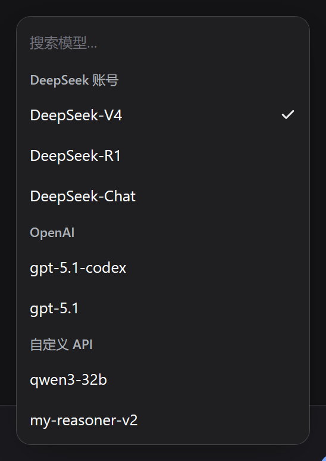
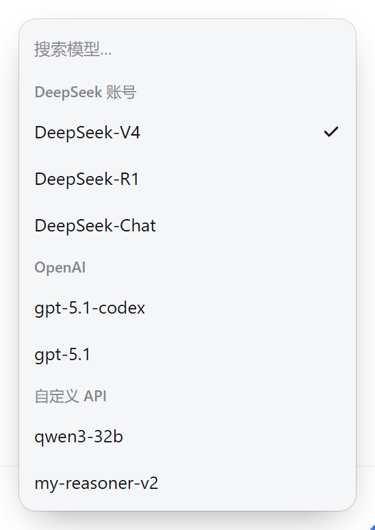
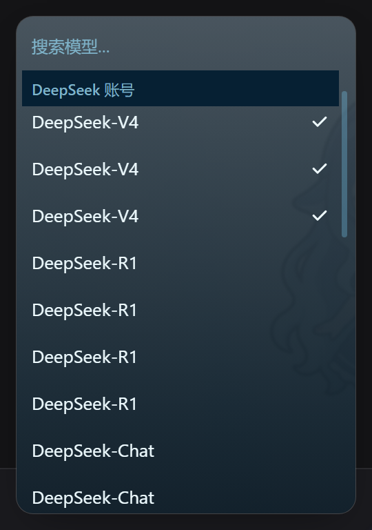
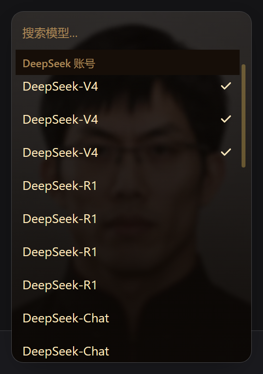

# dsh-thinking-bar

为 DeepSeek Harness 会话底部的模型 / 思考等级选择器提供**可切换外观**的纯 UI 插件。

对话输入框右下角那个「模型 · 档位」，默认长官方那样；装上这个插件，它可以变成六种滑杆皮肤之一。推理等级始终来自系统模型目录——插件只改外观，不写配置、不自建档位。

**兼容性：DeepSeek Harness `0.2.1-rc.2` 及以上**（`package.json` 的 `engines.dsh` 已声明，依赖该版本起的 `conversation.input.model.label` 子插槽与目录推理档位数据）。

## 特性

- **六种滑杆视觉**：Codex / 能量充能 / 曲率跃迁 / 量子纠缠 / 鲸鱼娘 / 梁圣，切换即时生效。
- **六套档位配色**：Codex / 极光 / 暖阳 / 深海 / 霓虹 / 莫兰迪，也可以逐档点色板自定义。
- **模型菜单对齐官方规格**：246px 窄卡、无框搜索、分组标题吸顶、选中只留勾、悬停纯 CSS（划过不重绘、不卡顿）。
- **推理等级吃官方数据**：每次打开重算 `catalog.reasoningFor()`，官方界面里改的自定义档位立即跟上；模型页顶部有「推理等级 → 当前档位」入口。
- **点击即时生效**：乐观更新，点完立刻收菜单换名字，失败自动回退。
- 浅色 / 深色主题自适应，跟随 DSH 的 `data-ds-dark-theme`。

## 截图

| 模型菜单（深色） | 模型菜单（浅色） |
|---|---|
|  |  |

| 鲸鱼娘 | 梁圣 |
|---|---|
|  |  |

## 安装

插件包自带构建好的 `client.js`，不需要 Node 环境：

```bash
# 在 DSH 里用插件管理器安装本仓库目录
plugin_manager install_bundle dsh-thinking-bar@1.0.0
```

或者手动把本目录链接到 DSH profile 的 `node_modules/dsh-thinking-bar`，重启后生效。

## 使用

**设置 → 思考等级栏**：

- **形态**：`官方`（默认，不接管任何座位）/ `Codex 滑杆`（接管输入框右侧那个座位）。
- **滑杆视觉**：六选一。
- **档位配色**：六套预设，或逐档点色板自定义。

设置页只保留一张固定模型 `DeepSeek-V4.1-Flash` 的样张，不读写主会话状态。

## 开发

```bash
node tools/build-plugin.mjs    # 由 lib/ui.js + 素材 + plugin-client-body.js 生成 client.js
node --check lib/ui.js         # UI 内核语法检查
```

独立 HTML 预览（不需要 DSH）：[`preview/index.html`](preview/index.html)，双击即可。预览与插件共用 `lib/ui.js` 外观内核。

仓库结构：

| 路径 | 作用 |
|---|---|
| `client.js` | 浏览器半侧构建产物（内联 `lib/ui.js` 与主题素材），勿手改 |
| `lib/ui.js` | 共享 UI 内核（预览与插件共用） |
| `plugin-client-body.js` | 插件 client 逻辑（设置页、模型座位、偏好存储） |
| `index.js` | Host 半侧空实现（纯 UI 插件） |
| `preview/` | 独立 HTML 预览 |
| `docs/screenshots/` | README 用截图 |

## 致谢

致谢：本插件的“梁圣”视觉概念与人物图片素材源自 [Lichtspektrum/liang-intensity-calibrator](https://github.com/Lichtspektrum/liang-intensity-calibrator)。

感谢以下项目提供的灵感来源：

- [MuFeng262/dsh-thinking-slider](https://github.com/MuFeng262/dsh-thinking-slider)
- [Lichtspektrum/liang-intensity-calibrator](https://github.com/Lichtspektrum/liang-intensity-calibrator)

「鲸鱼娘」素材由作者使用 Gemini 生成后去白底处理；主题 token 与组件约定来自 DeepSeek Harness。

## 许可

代码以 [MIT](LICENSE) 发布。第三方素材的署名信息见上方致谢。
