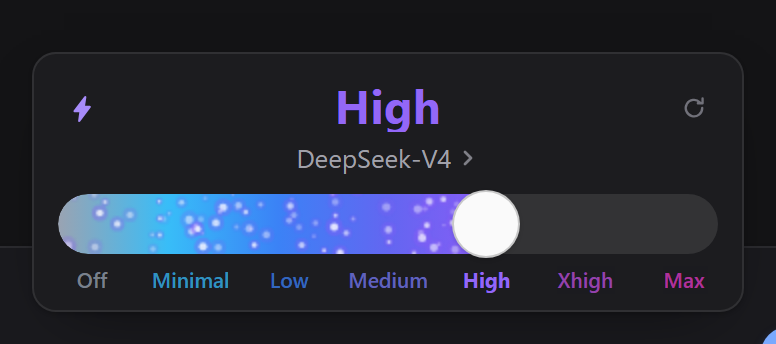
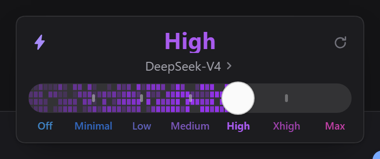
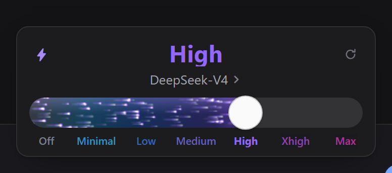
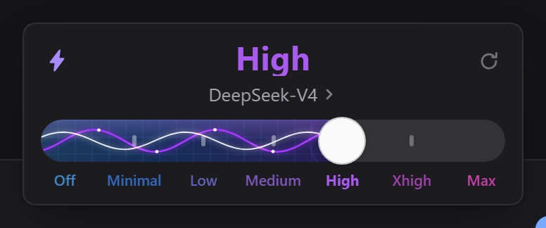
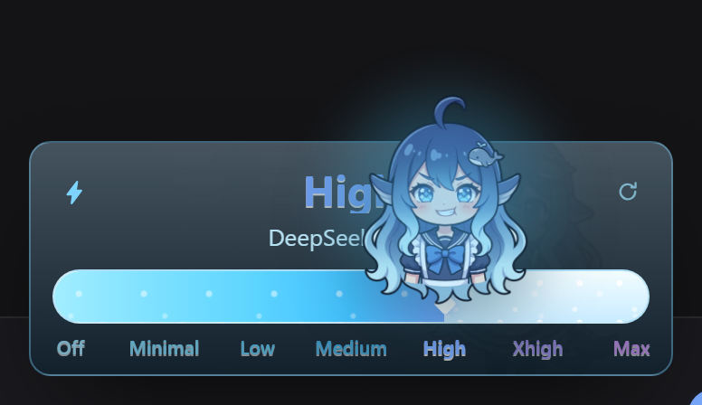
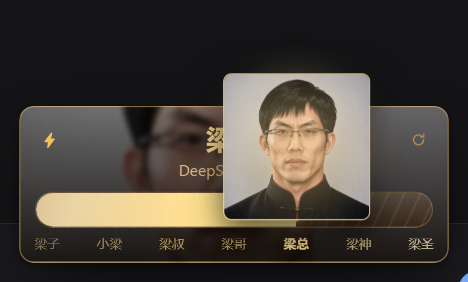
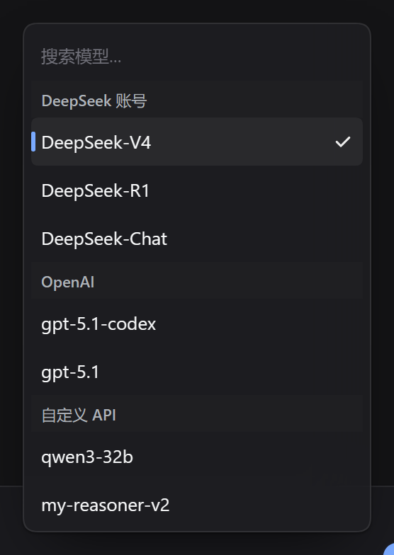
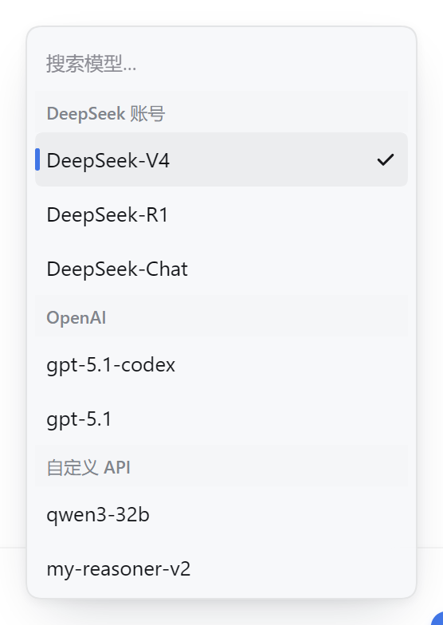
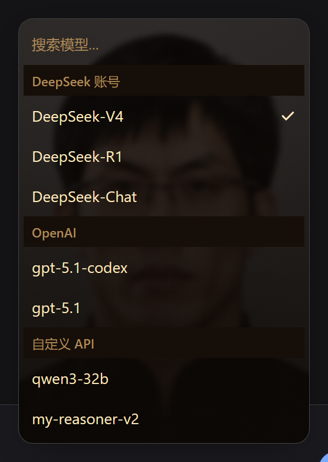
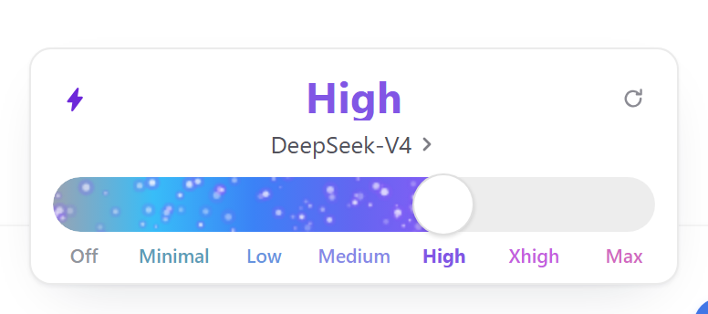

# dsh-thinking-bar

为 DeepSeek Harness 会话底部的模型 / 思考等级选择器提供**可切换外观**的纯 UI 插件。

对话输入框右下角那个「模型 · 档位」，默认长官方那样；装上这个插件，它可以变成六种滑杆皮肤之一。推理等级始终来自系统模型目录——插件只改外观，不写配置、不自建档位。

**兼容性：DeepSeek Harness `0.2.1-rc.2` 及以上**（`package.json` 的 `engines.dsh` 已声明，依赖该版本起的 `conversation.input.model.label` 子插槽与目录推理档位数据）。

## 特性

- **六种滑杆视觉**：Codex / 能量充能 / 曲率跃迁 / 量子纠缠 / 鲸鱼娘 / 梁圣，切换即时生效。
- **六套档位配色**：Codex / 极光 / 暖阳 / 深海 / 霓虹 / 莫兰迪，也可以逐档点色板自定义。
- **模型菜单对齐官方规格**：246px 窄卡、无框搜索、分组标题吸顶、选中只留勾、悬停纯 CSS（划过不重绘、不卡顿）。
- **推理等级吃官方数据**：每次打开重算 `catalog.reasoningFor()`，官方界面里改的自定义档位立即跟上；模型页顶部有「推理等级 → 当前档位」入口。
- **点击即时生效**：乐观更新，点完立刻收菜单换名字，失败自动回退。
- 浅色 / 深色主题自适应，跟随 DSH 的 `data-ds-dark-theme`。

## 截图

点开输入框右下角的「模型 · 档位」，弹层长这样：

| Codex | 能量充能 | 曲率跃迁 |
|---|---|---|
|  |  |  |

| 量子纠缠 | 鲸鱼娘 | 梁圣 |
|---|---|---|
|  |  |  |

模型列表（同一弹层的另一页，打开即定位到当前模型）：

| 深色 | 浅色 | 梁圣主题 |
|---|---|---|
|  |  |  |

浅色主题：



## 安装

> 前置：DeepSeek Harness **0.2.1-rc.2 及以上**。仓库里带的是**预构建好的 `client.js`**，装完即用，**不需要编译、不需要装 Node**。
>
> 下面四种方式任选其一。

### 方式一：npm 安装

```bash
dsh plugin --profile desktop add dsh-thinking-bar
```

也可以不敲命令：插件 → **添加插件** → 填纯包名 `dsh-thinking-bar`（会从 npm 解析）。

> npm 上是**预构建包**，装完不需要编译。若 `npm view dsh-thinking-bar version` 显示的版本比你期望的旧，改用下面的 GitHub 方式装最新代码。

### 方式二：图形界面

1. 打开 DSH，左侧点 **插件** → 右上角 **添加插件**。
2. 在「包名或地址」里填下面任意一种：
   - 从 npm 装：`dsh-thinking-bar`（最省事）
   - 从 GitHub 装：`github:TonyKingWJX/dsh-thinking-bar`
   - 本地目录绝对路径：先 `git clone`（或下载源码包解压），再填这个文件夹的路径，例如 `D:\Apps\dsh-thinking-bar`
3. 点 **安装**，装完按提示刷新页面（或重启 DSH）。
4. 插件列表里确认「思考等级栏 / dsh-thinking-bar」处于**启用**状态。

> 若 `github:` 这种写法在你的版本上解析不了（部分解析器只认包名和本地路径），直接用下面的命令行方式或填本地路径，效果一样。

### 方式三：命令行（从 GitHub 装）

```bash
# 从 GitHub 仓库装（等价于 pnpm add github:TonyKingWJX/dsh-thinking-bar）
dsh plugin --profile desktop add "github:TonyKingWJX/dsh-thinking-bar"

# 或者先 clone 到本地，再从目录装（最稳，不依赖远端解析）
git clone https://github.com/TonyKingWJX/dsh-thinking-bar
dsh plugin --profile desktop add "link:D:/Apps/dsh-thinking-bar"
```

`--profile` 换成你实际在用的 profile（常见是 `desktop` / `web` / `tui`，对应 `~/.dsh/profiles/<名字>/`）。

这两种写法都等价于在 profile 目录里跑 `pnpm add`，装完重启 DSH 即可。若重启后插件列表里没有它，说明只装进了依赖、没进组合列表，把 `~/.dsh/profiles/<profile>/package.json` 的 `dsh.profile.bundles` 补一行 `"dsh-thinking-bar"` 再重启（界面的「添加插件」不会遇到这个问题）。

### 方式四：手动改 profile（离线 / 内网）

1. 把仓库 `git clone`（或下载源码包解压）到任意目录，记下绝对路径。
2. 编辑 `~/.dsh/profiles/<profile>/package.json`：
   - `dependencies` 里加 `"dsh-thinking-bar": "link:D:/Apps/dsh-thinking-bar"`
   - `dsh.profile.bundles` 数组末尾加 `"dsh-thinking-bar"`
3. 在该目录执行 `pnpm install`（会建 `node_modules/dsh-thinking-bar` 链接）。
4. 重启 DSH。

### 装好后

打开 **设置 → 思考等级栏**，把「形态」切到 `Codex 滑杆`；输入框右下角的模型边上就会变成可点的「模型 · 档位」。

## 卸载

- **图形界面**：插件 → 思考等级栏 → **卸载**（想临时关掉用开关「停用」即可）。
- **命令行**：
  ```bash
  dsh plugin --profile desktop remove dsh-thinking-bar
  ```
- **手动**：从 `~/.dsh/profiles/<profile>/package.json` 的 `dependencies` 和 `dsh.profile.bundles` 里删掉 `dsh-thinking-bar`，执行 `pnpm install`，重启。

> 想升级到新版本：这个插件的安装页不支持直接"更新"，按上面步骤**先卸载再安装**即可。

## 使用

**设置 → 思考等级栏**：

- **形态**：`官方`（默认，不接管任何座位）/ `Codex 滑杆`（接管输入框右侧那个座位）。
- **滑杆视觉**：六选一。
- **档位配色**：六套预设，或逐档点色板自定义。

设置页只保留一张固定模型 `DeepSeek-V4.1-Flash` 的样张，不读写主会话状态。

## 开发

```bash
node tools/build-plugin.mjs    # 由 lib/ui.js + 素材 + plugin-client-body.js 生成 client.js
node --check lib/ui.js         # UI 内核语法检查
```

独立 HTML 预览（不需要 DSH）：[`preview/index.html`](preview/index.html)，双击即可。预览与插件共用 `lib/ui.js` 外观内核。

仓库结构：

| 路径 | 作用 |
|---|---|
| `client.js` | 浏览器半侧构建产物（内联 `lib/ui.js` 与主题素材），勿手改 |
| `lib/ui.js` | 共享 UI 内核（预览与插件共用） |
| `plugin-client-body.js` | 插件 client 逻辑（设置页、模型座位、偏好存储） |
| `index.js` | Host 半侧空实现（纯 UI 插件） |
| `preview/` | 独立 HTML 预览 |
| `docs/screenshots/` | README 用截图 |

## 致谢

致谢：本插件的“梁圣”视觉概念与人物图片素材源自 [Lichtspektrum/liang-intensity-calibrator](https://github.com/Lichtspektrum/liang-intensity-calibrator)。

感谢以下项目提供的灵感来源：

- [MuFeng262/dsh-thinking-slider](https://github.com/MuFeng262/dsh-thinking-slider)
- [Lichtspektrum/liang-intensity-calibrator](https://github.com/Lichtspektrum/liang-intensity-calibrator)

「鲸鱼娘」素材由作者使用 Gemini 生成后去白底处理；主题 token 与组件约定来自 DeepSeek Harness。

## 许可

代码以 [MIT](LICENSE) 发布。第三方素材的署名信息见上方致谢。
